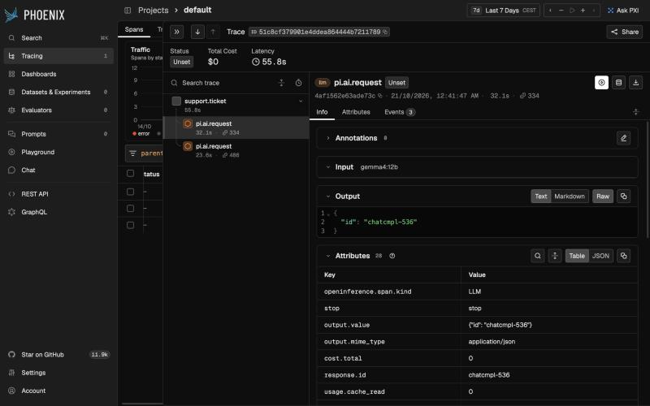

# pi-otel

**See every Pi model call in the observability stack you already use.**

[](https://github.com/aantenore/pi-otel/actions/workflows/ci.yml)


[Pi](https://github.com/earendil-works/pi) speaks a small, vendor-neutral telemetry contract
([`@earendil-works/pi-telemetry`](https://www.npmjs.com/package/@earendil-works/pi-telemetry)) but ships no exporter.
`pi-otel` is the missing adapter: one line turns that contract into **OpenTelemetry** spans, metrics and trace
propagation, so Jaeger, Grafana Tempo, Honeycomb, Datadog, Langfuse, Arize Phoenix or any OTLP backend can show
what your agents are doing, what they cost and where the time goes.

```ts
const telemetry = createOtelTelemetry({ genAi: true });
```



*A real trace: one application span, two `pi.ai.request` calls to a local `gemma4:12b` through Ollama, exported with
`pi-otel` and rendered by Arize Phoenix. Phoenix recognises them as LLM calls because `genAi: true` adds the
OpenTelemetry GenAI semantic-convention attributes.*

## Why

- **Passes Pi's official adapter conformance suite**: the same tests the contract authors ship, run in CI.
- **No lock-in.** It builds on `@opentelemetry/api`, so you pick the SDK, exporter and backend. Zero runtime dependencies.
- **GenAI semantic conventions** (`gen_ai.request.model`, `gen_ai.usage.*`, finish reasons) on Pi's model spans, so LLM-aware
  backends light up without custom dashboards.
- **Faithful to the contract**: explicit parents (no hidden async context), callback-owned span lifetime,
  last-write-wins status, failures that never break your code.
- **Distributed traces**: `inject` / `extract` with W3C Trace Context to follow one task across services and workers.

## Compatibility at a glance

| Pi package | Telemetry hook | Status |
|---|---|---|
| `@earendil-works/pi-telemetry` 1.3 | contract + conformance suite | supported, tested in CI |
| `@earendil-works/pi-ai` | per-request parent span (`telemetry` on `main`, `telemetryContext` in 1.3) | the 1.3.0 release forwards the parent but emits no spans yet; spans like `pi.ai.request` are on `main` and verified end to end with this adapter |
| `@earendil-works/pi-durable`, `chord` | `TelemetryContext` options | instrumentation on `main`; works with any `TelemetryContext` |
| `pi` coding agent (CLI) | – | does not accept a telemetry context today |

Links require an OpenTelemetry SDK whose `Span` implements `addLink` (`@opentelemetry/sdk-trace-base` 2.x); with older SDKs
`span.addLink` is a silent no-op, while links passed to `startSpan` depend on the SDK honouring `links`.

## Install

```bash
npm install @aantenore/pi-otel @opentelemetry/api @earendil-works/pi-telemetry
```

`@opentelemetry/api` (^1.9) and `@earendil-works/pi-telemetry` (^1.3) are peer dependencies (the Pi package is optional at runtime: it is only used for types). Node >= 22.19.

## Usage

```ts
import { createOtelTelemetry } from "@aantenore/pi-otel";

const telemetry = createOtelTelemetry(); // tracer, meter and propagator come from the OpenTelemetry globals
```

### With pi-ai

Start a span and hand it to the request as its explicit parent. pi-ai 1.3 accepts the parent through the `telemetryContext` request option:

```ts
await telemetry.startSpan(
  { name: "pi.ai.request", attributes: { provider: model.provider, model: model.id } },
  async (span) => {
    const message = await models.completeSimple(model, context, { telemetryContext: span });
    span.setAttributes({ stop: message.stopReason, "usage.input": message.usage.input });
    return message;
  },
);
```

### With pi-durable

```ts
const harness = createHarness({ telemetry: createOtelTelemetry() });
```

Any option or parameter typed as `TelemetryContext` accepts the adapter (the option name and availability depend on the version of the consuming package). Parents are always passed explicitly; the adapter does not use `AsyncLocalStorage` or the OpenTelemetry active context.

### OpenTelemetry SDK setup

```ts
import { NodeSDK } from "@opentelemetry/sdk-node";
import { OTLPTraceExporter } from "@opentelemetry/exporter-trace-otlp-http";
import { OTLPMetricExporter } from "@opentelemetry/exporter-metrics-otlp-http";
import { PeriodicExportingMetricReader } from "@opentelemetry/sdk-metrics";
import { W3CTraceContextPropagator } from "@opentelemetry/core";

new NodeSDK({
  serviceName: "my-service",
  traceExporter: new OTLPTraceExporter({ url: "http://localhost:4318/v1/traces" }),
  metricReader: new PeriodicExportingMetricReader({
    exporter: new OTLPMetricExporter({ url: "http://localhost:4318/v1/metrics" }),
  }),
  textMapPropagator: new W3CTraceContextPropagator(),
}).start();
```

Create the adapter before or after the SDK starts; the default tracer and meter resolve lazily through the API globals. You can also inject them:

```ts
createOtelTelemetry({ tracer, meter, propagator, tracerName: "my-app", root: someContext });
```

| Option | Default | Purpose |
|---|---|---|
| `tracer` | `trace.getTracer(tracerName)` | Tracer used for all spans |
| `meter` | `metrics.getMeter(tracerName)` | Meter used for instruments |
| `propagator` | `propagation` global | Used by `inject` / `extract` |
| `tracerName` | `@aantenore/pi-otel` | Instrumentation scope of the default tracer and meter |
| `genAi` | `false` | Add GenAI semantic-convention attributes |
| `root` | `ROOT_CONTEXT` | Parent of top-level spans |

## GenAI attributes

With `genAi: true`, spans named `pi.ai.request` get these attributes in addition to the original ones:

| Source attribute | Added attribute |
|---|---|
| (constant) | `gen_ai.operation.name` = `chat` |
| `provider` | `gen_ai.provider.name` |
| `model` | `gen_ai.request.model` |
| `usage.input` + `usage.cache_read` + `usage.cache_write` | `gen_ai.usage.input_tokens` (sum of the values present in the same attribute batch) |
| `usage.output` | `gen_ai.usage.output_tokens` |
| `usage.cache_read` | `gen_ai.usage.cache_read.input_tokens` |
| `usage.cache_write` | `gen_ai.usage.cache_creation.input_tokens` |
| `stop` | `gen_ai.response.finish_reasons` (array; `stop`, `length`, `error` kept, `toolUse` becomes `tool_call`, unknown values unchanged) |
| `response.id` | `gen_ai.response.id` |

The span is also started with `SpanKind.CLIENT`; span names are not changed.

pi-ai's `usage.input` excludes cached tokens, while the GenAI convention's `gen_ai.usage.input_tokens` includes them,
hence the sum above. The original `usage.*` attributes are left untouched.

The table lives in `src/genai.ts` (`GENAI_RULES`); mappings are applied to the start attributes and to every `setAttributes` batch.

## Mapping

| pi-telemetry | OpenTelemetry |
|---|---|
| `startSpan` | child span of the explicit parent; ended when the callback value/promise settles |
| normal completion | status left `UNSET` (OpenTelemetry convention for success) |
| `setStatus({ status: "ok" })` | `SpanStatusCode.OK` |
| `setStatus({ status: "error", error })` | `SpanStatusCode.ERROR`, message = `error.message`, attribute `error.type` = `error.name` |
| throw / rejection | `ERROR` with the error message, `error.type`, and `recordException`; an explicit status takes precedence |
| repeated `setStatus` | last write wins (applied once at settlement) |
| `setAttributes` / start attributes | merged; `undefined` dropped; arrays copied; unsupported values dropped |
| `addEvent(name, attrs)` | span event |
| calls after settlement | ignored; a child started on a settled span runs its callback without recording |
| recording failures | suppressed; the callback always runs exactly once |

## Extensions beyond the 1.3 contract

The 1.3.0 contract has only `startSpan`, `addEvent`, `setAttributes` and `setStatus`. The adapter additionally provides the following. They are optional for consumers and invisible to code that only uses `TelemetryContext`.

- **Links**: `startSpan({ name, links: [{ context, attributes? }] })` and `span.addLink(link)`. `context` must be a span or context produced by this adapter (including `propagation.extract` results); other values are skipped.
- **Metrics** (`telemetry.metrics`): `counter(name, opts?).add(v, attrs?)`, `upDownCounter(name, opts?).add(v, attrs?)`, `histogram(name, opts?).record(v, attrs?)`; `opts` = `{ unit?, description? }`. Instruments are cached by name, unit and description; different options create a distinct instrument.
- **Propagation** (`telemetry.propagation`): `inject(span)` returns a carrier (`Record<string, string>`); `extract(carrier)` returns a context whose children continue the remote trace.

```ts
const carrier = await telemetry.startSpan({ name: "client.call" }, (span) =>
  telemetry.propagation.inject(span),
);
// ...on the receiving side
await telemetry.propagation.extract(carrier).startSpan({ name: "server.handle" }, async () => {});
```

## Limitations

- A span ends only through the callback; there is no manual `end()`.
- Without a registered propagator (or an explicit `propagator` option) `inject` returns an empty carrier and a one-time `diag.warn` is emitted; register one such as `W3CTraceContextPropagator`.
- Spans created while the OpenTelemetry API has no registered SDK are non-recording.
- Telemetry attributes are forwarded as given; do not record prompts, completions, credentials or other sensitive data.

## Run the demo

`examples/ollama-phoenix.mjs` reproduces the screenshot: a local Ollama model, Arize Phoenix as the backend
(`uvx --from arize-phoenix phoenix serve`), and a pi-ai build with telemetry (`PI_AI_DIST=/path/to/pi/packages/ai/dist`).

## Development

```bash
npm ci
npm run typecheck
npm test
npm run build
```

## License

MIT
